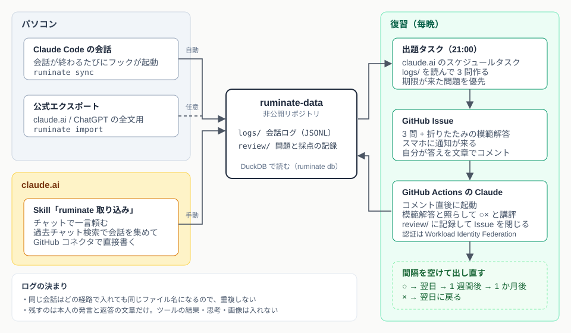

# はじめに

Claude Codeやclaude.aiと毎日のように話しているのですが、会話の中で「なるほど」と思ったことを翌週にはきれいに忘れている、ということが増えてきました。調べ物も設計の相談もAI相手に済むようになった分、自分の頭を通らずに流れていってしまう感覚があります。

以前読んだ[『科学的根拠に基づく最強の勉強法』](https://link.amazon/B00ODfgec)に、覚えるには読み返すのではなく思い出す練習をするのがよい、と書いてあったのを思い出して、AIとの会話をためておいてそこから復習問題を作って毎晩出題してもらう仕組みを作りました。反芻するという意味でruminateという名前にしています。

この記事では、どんな構成にしてなぜそうしたのか、本の方法をどう仕組みに落としたか、1日の流れ、作る途中でつまずいたことを書いていきたいと思います。

# 全体の構成

大きく分けると会話を集める側と問題を出す側に分かれています。会話のログは非公開のリポジトリ（`ruminate-data`）にためて、コードは公開のリポジトリ（`ruminate`）に置いています。

https://github.com/futabooo/ruminate



集める側は3本あります。

1つ目はClaude Codeです。ターミナルで会話が終わるたびにプラグインのフックから`ruminate sync`が動いて、会話を変換してpushします。会話ファイル（`~/.claude/projects/`のJSONL）から自分の発言とClaudeの返答の文章だけを取り出して、ツールの実行結果や思考、サブエージェントの会話は捨てています。APIキーや電話番号らしい文字列は伏せ字にしています。

2つ目はclaude.aiの会話です。これは手元から読む方法がないので、claude.aiのチャットで「ruminate取り込み」と頼むと動くSkillを作りました。過去チャット検索で直近の会話を集めて、GitHubコネクタで直接リポジトリに書きます。公式のエクスポートを`ruminate import`で入れる道も用意していて、どちらで入れても同じファイル名になるので重複しません。

3つ目が出題と採点です。claude.aiのスケジュールタスク（Claude Codeタスク）が毎晩`ruminate-data`を読んで3問作ってGitHub Issueに立てます。自分がIssueにコメントで答えると、GitHub Actionsで動くClaudeが数分で採点と講評を返してIssueを閉じて、記録を`review/`に書きます。

データは全部JSONLで、見るときはDuckDBです。`ruminate db`と打つとビューが用意された状態でDuckDBが開いて、`SELECT * FROM sessions`のように会話を横断して検索できます。

```
┌─────────────┬──────────────┬─────────────┬─────────┬───────┬─────────────────────────────────────┐
│    agent    │   project    │   started   │ prompts │ turns │                title                │
├─────────────┼──────────────┼─────────────┼─────────┼───────┼─────────────────────────────────────┤
│ claude-code │ ruminate     │ 10-28 22:42 │       1 │     2 │ ruminateプラグインの動作            │
│ claude-code │ chezmoi      │ 10-28 14:48 │       4 │     8 │ push.autoSetupRemote グローバル設定 │
│ claude-ai   │              │ 10-27 19:07 │      40 │    79 │ 勉強法の振り返りSkill               │
└─────────────┴──────────────┴─────────────┴─────────┴───────┴─────────────────────────────────────┘
```

# なぜこの構成にしたのか

こうやって書き出してみるとRustのCLIとClaude Codeのプラグイン、claude.aiのSkill、スケジュールタスク、GitHub Issue、GitHub Actionsと、いろんなものを継ぎ足したような構成になっています。会話をためるDBとAPIを持った専用のアプリケーションを作ってどこかにデプロイした方がシンプルだったのでは？と自分でも思ったので、なぜこうなったのかを書いておきます。

一番大きいのは、自分で運用するものを増やしたくなかったことです。毎晩動くものを自分でホスティングすると、サーバーなりWorkerなりの面倒を見ることになるし、問題を作るのも採点するのもLLMなので結局APIキーの管理やコストの管理が発生します。claude.aiのスケジュールタスクに乗せてしまえば、パソコンを閉じていても毎晩動くし、動かすための基盤は何も持たなくてよいです。

次に、会話のログは仕事の話も家庭の話も混ざる個人データなので、置き場所にはあまり冒険したくなかったというのがあります。GitHubの非公開リポジトリなら保存先と権限管理と履歴が最初からあって、claude.aiのGitHubコネクタやClaude Codeタスクからそのまま読み書きできます。自分でストレージと認証を作る必要がなくなるので、ここをGitHubにしたことで他の部分も自然とGitHubに寄っていきました。

問題を出す場所をGitHub Issueにしたのも同じ理由です。通知が来て、コメントで答えて、終わったら閉じる、というのがやりたいことそのままだし、スマホのGitHubアプリからも答えられます。UIをつくる必要がない上に、答えと講評がIssueに残るので後から見返すこともできます。

採点をGitHub Actionsにしたのは、答えをコメントしたらすぐ返ってきてほしかったからです。最初は翌晩の出題タスクがまとめて採点する設計だったのですが、1日遅れでフィードバックが来ても自分が何て答えたか覚えていないので、Issueのコメントをきっかけに動くActionを置きました。認証はWorkload Identity Federationにして、リポジトリにAPIキーを置かないようにしています。

パソコン側をRustのCLIにしたのは、Claude Codeの会話ファイルは手元にしかないので手元で動くものが必要で、会話の終わりに毎回フックから呼ばれるので起動が速くて依存のないバイナリ1つにしたかったからです。データをDBに入れずJSONLのままDuckDBで読んでいるのも、サーバーを立てずにファイルを置いておくだけで済ませたいという同じ発想です。

そのかわりセットアップは手でやることが多くて、READMEにも10ステップぐらいの手順が並んでいます。自分1人で使うものなのでそこは割り切っていますが、人に使ってもらうならセットアップ用のSkillを作るとかもう少しなんとかしないといけないなと思っています。

# 本の方法をどう仕組みに落としたか

本で紹介されている方法のうち、仕組みで強制できるものを選びました。

| 本の方法 | 仕組みでの形 |
|---|---|
| アクティブリコール（思い出す練習） | 会話を読み返させず、「なぜ」「どう違う」の形の問いをIssueで出す |
| 分散学習（間隔を空けて繰り返す） | 問題ごとに段階を持ち、正解すると翌日 → 1週間後 → 1か月後と間隔が延びる。間違えると翌日に戻る |
| 交互学習（別の話題を混ぜる） | 1晩の3問は別々の話題から。同じ会話から2問続けない |
| 自己説明（理由を自分の言葉で言う） | ○×の自己採点ではなく、答えを文章で書く。説明がない一言は× |
| すぐのフィードバック | 答えを書いたら数分で講評が返る。模範解答もIssueの折りたたみに入れてあり、書いたあとに自分で確かめられる |

最初は答えを同じ通知に入れておいて自分で○×を付ける設計にしていたのですが、それだと答えを見てから分かった気になるだけだなと思ったので、文章で書いてClaudeに採点してもらう形にしました。答えを書く手間は増えますが、それ自体が自己説明なのでここは手間をかける価値があるかなと思っています。

# 1日の流れ

毎晩21時にGitHubから通知が来ます。Issueにはこんな問題が並びます。

> 1. Android 14以降でGoogleがPlay経由でルート証明書を更新しても、旧Dart SDKでビルドしたアプリのdart:ioのHTTPSが守られないのはなぜ？
> 2. Claudeのサブエージェントとherdrで立てるエージェントでは、実体と人間の介入のしやすさがどう違う？
> 3. push.default = currentの状態でpush.autoSetupRemote = trueを足すと、新しいブランチの初回git pushで何が変わる？

どれもここ1週間のClaude Codeでの会話から作られたものです。コメントに答えを書くと、数分でこう返ってきます。

> 採点: ○ 0 / × 3
>
> 1. × 「OSの証明書を使っていない」というより、旧Dartは固定パス/system/etc/security/cacertsを読んでいて、Playで更新されるConscrypt APEXのストアを見ていないのが核心です。「古い置き場所を見続けている → SDKを上げて再ビルド」で覚えましょう。
> 2. × herdr側が独立していて対話的、までは方向が合っています。ただ、サブエージェントは親の中の使い捨て呼び出しで途中が見えず要約だけ返る点、herdrは別ペインの独立プロセスで会話が見え、承認ダイアログに人間が直接答えられ、親が落ちても残る点が抜けています。
> 3. × push.default = currentならリモートブランチはもともと作られます。autoSetupRemoteで増えるのは「-uなしでも追跡（upstream）設定まで自動でされる」ことです。

初日は3問とも×でした。会話したときは分かったつもりだったのに核心を自分の言葉で言えていない、というのがはっきり出ていて、作った甲斐があったなと思っています。間違えた問題は翌日にもう一度出ます。

# 設計で決めたこと

細かいところでは次のようなことを決めました。

**コードと個人データを分ける。** 会話ログには仕事の話も家庭の話も混ざるので、コードは公開、データは非公開の別リポジトリにしました。仕事のプロジェクトは設定で最初から除外できるようにしています。

**1会話1ファイル、変わったら丸ごと作り直す。** Claude Codeの会話ファイルは追記しかされないので、更新の検出はサイズと更新時刻を見るだけで済みます。ファイル名は会話の開始時刻とIDから決まるので、どの経路で入れても同じ場所に上書きされます。

**Markdownは置かない。** 人が読む用のファイルは作らず、JSONLだけを置いてDuckDBで読みます。探す・絞る・数えるには十分ですが、1つの会話を通して読むには表は向いていないので、各行に元の会話のURLを持たせて、読みたいときはclaude.aiや`claude --resume`で元の会話に戻る前提にしています。出題タスクもDuckDBかjqで読めばよいので整形の手間がありません。

**同じファイルを2か所から書かない。** `logs/`はパソコンと取り込み、`review/`は出題と採点だけが書きます。pushの前に`pull --rebase`するので、同じ夜に複数がpushしてもぶつかりません。

# つまずいたこと

作る過程で分かったことをまとめておきます。2026年10月末時点の話なので、変わっているかもしれません。

**claude.aiのスケジュールタスクには過去チャット検索がない。** 最初は毎日claude.aiの会話を拾うタスクを作ろうとしたのですが、リポジトリを指定しても指定しなくても、タスクの環境には検索ツールが出てきませんでした。設定で「チャットの検索と参照」をオンにしていても同じです。普通のチャットには検索があるので、取り込みはSkillにして自分が一言頼む形にしました。

**リポジトリを指定したタスクはClaude Codeタスクになる。** `git`と`gh`が使えて、`main`に直接pushもできました。一方で作業用の`claude/…`ブランチが残ります。

**普通のチャットのGitHubコネクタはmainに直接書ける。** 接続の確認は出ますが、ファイルの作成と更新ができました。取り込みSkillはこれで書いています。

**GitHub ActionsのOIDCの`sub`が2026年7月15日以降に作ったリポジトリでは変わっている。** 採点のActionはAnthropicのWorkload Identity Federationで認証しているのですが、ルールのsubjectを`repo:futabooo/ruminate-data:ref:refs/heads/main`と書いたら一致せず、実際は`repo:futabooo@<ユーザーID>/ruminate-data@<リポジトリID>:ref:refs/heads/main`のようにユーザーとリポジトリの数値IDが入る形式でした。Consoleの認証イベントに`match_subject_prefix`と出て気づきました。

**Consoleのクレジットが0だと、認証は通るのにAPI呼び出しが失敗する。** Actionのログには理由が出ず（ツールの出力を隠す設定なので）、認証イベントは成功になっていてしばらく悩みました。クレジットを入れたら動きました。

**伏せ字は正規表現なので完全ではない。** 仕事のプロジェクトは除外する前提で、安全網としてだけ使っています。

# おわりに

まだ動き始めたばかりなので、続けてみてどうだったかは毎月のふりかえりで書こうと思います。問題の質と採点の厳しさが続けられる範囲に収まるかが一番の関心事です。ChatGPTのエクスポートも読めるようにしてあるので、そちらの会話も混ぜていく予定です。

仕組みに興味があればREADMEに手順をまとめてあるので見てもらえると嬉しいです。

https://github.com/futabooo/ruminate
