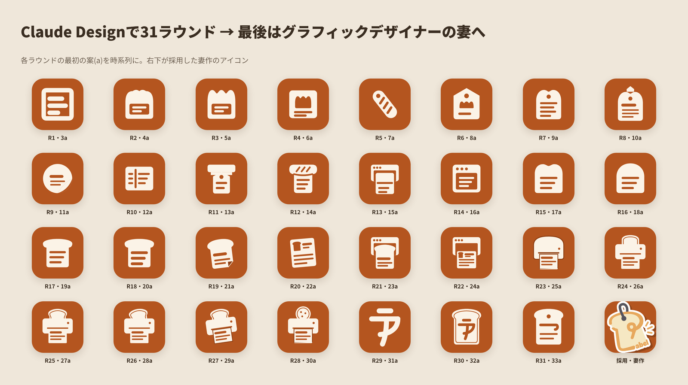
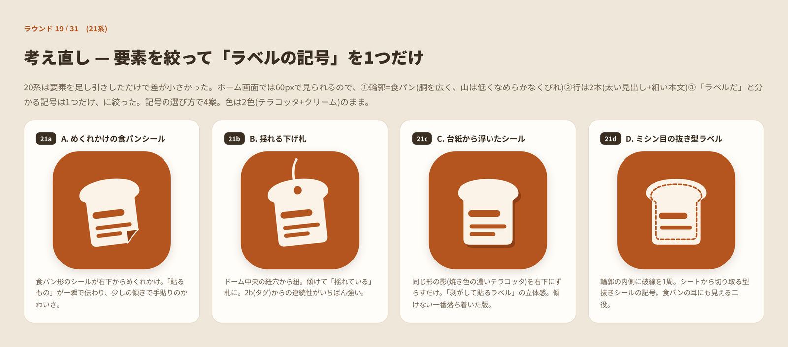
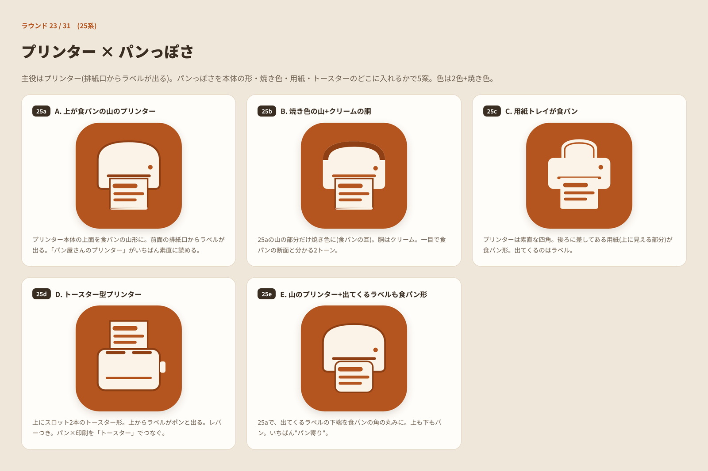
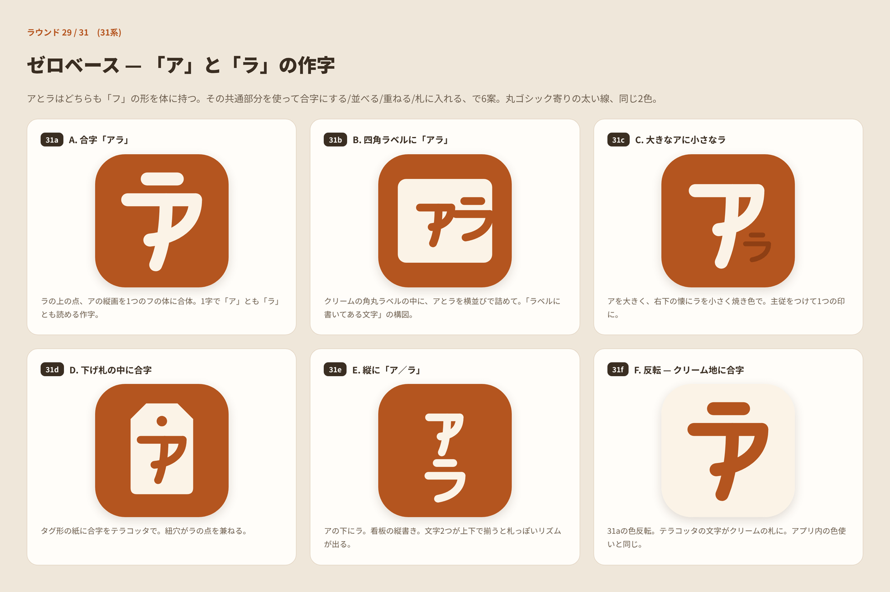
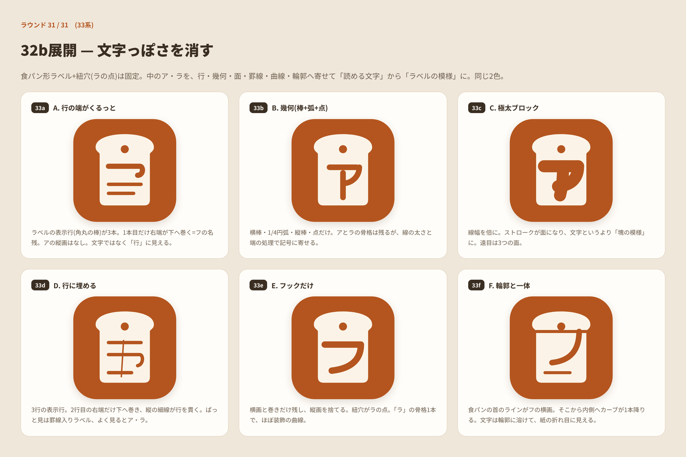
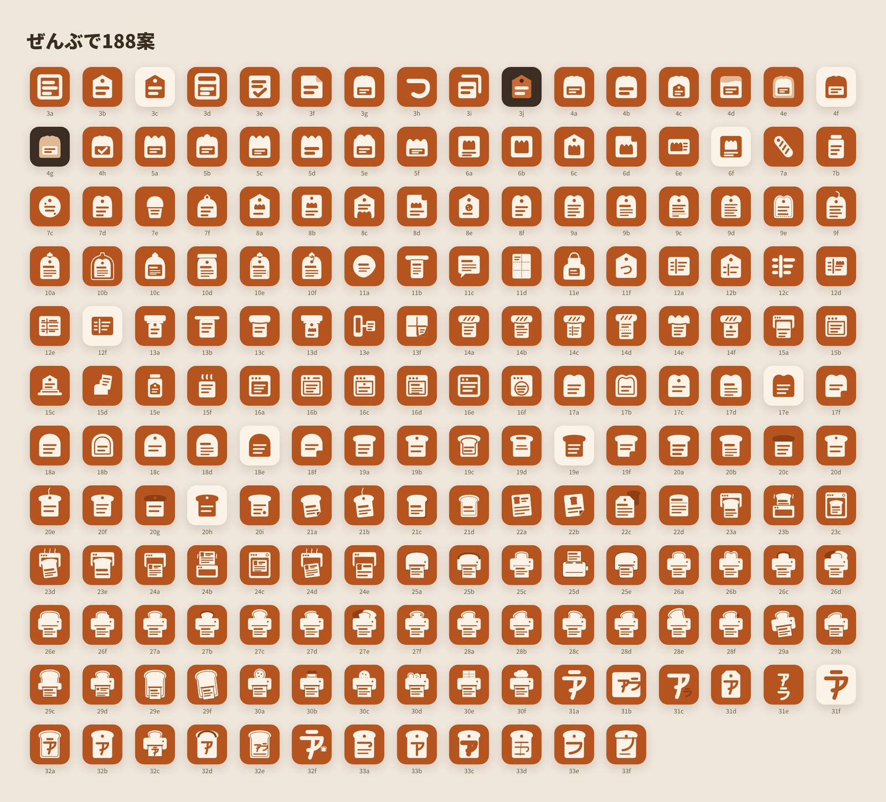
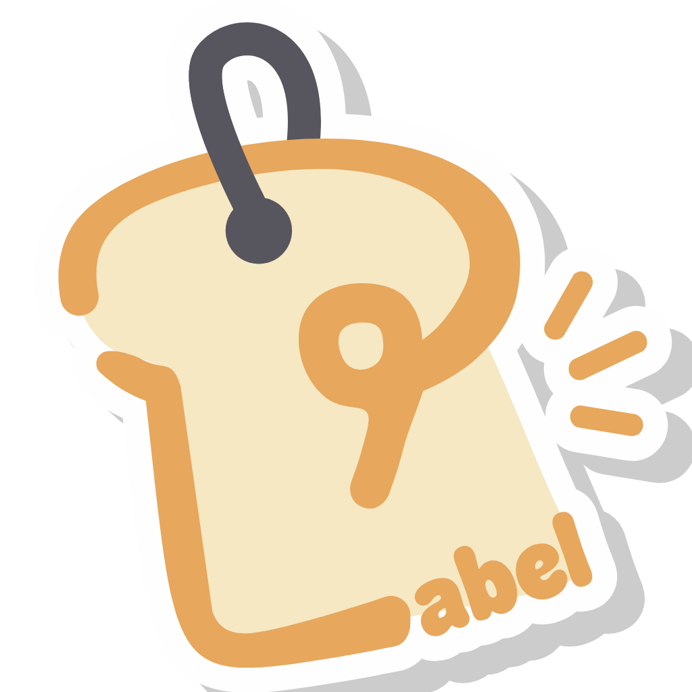

---

title: "自分がAI使ってたら絶対作れないお気に入りのアイコンを作ってもらった"
description: "アルティラベルのアプリアイコンをClaude Designで188案つくったけどしっくりこなくて、最後はグラフィックデザイナーの妻に作ってもらった話"
tags: ["diary", "design", "Claude"]
pubDate: "2026/11/09"
eyeCatchImg: "./assets/20261109120000.png"
eyeCatchAlt: "Claude Designで出した188案の一部と、妻が作った採用アイコン"
---

砂場活動で作ってる食品ラベル印刷アプリ「アルティラベル」のアプリアイコンを作った。

最初はClaude Designで作ろうとして188案ぐらい出してもらったけど全然しっくりこなくて、最終的に[グラフィックデザイナーの妻](https://x.com/0000taisou)にお願いしたらめっちゃかわいいのがでてきた。

各ラウンドの最初の案を順番に並べたやつで、右下が妻が作ったやつ。最後の1個だけ明らかに違うのが混ざってるｗ

# Claude Designでつくった

最初は小さいサイズでもちゃんと見えるようにと思って、単色の背景に記号1個だけ、グラデーションとか傾きはなし、色はテラコッタとクリームの2色、みたいなルールを決めてやってた。

そこから食パンにラベルを貼るとか、ラベルの中に食パンを入れるとか、値札タグの上を食パンの山にするとか、とにかく組み合わせをいっぱい出してもらった。途中でプリンターから出てくるやつとかオーブンから出てくるやつとかもやってみたけど、結局食パンに戻ってくる。

食パンの形のラベルを細かく変えていくうちに違いがよくわからなくなってきたので、要素を減らしてラベルっぽい記号を1個だけにしたのがこれ。

そのあとプリンターの用紙トレイに食パンが刺さってるやつが一番よさそうだったので、パンの形を変えたり傾けたり、刺すものをクッキーとかジャムの瓶とかコック帽にしたりしてみた。食パンだけ傾けたら刺さった紙がズレたようにしか見えなくて、傾けるなら全体ごとか足元を支点にしないとダメ、みたいな学びもあった。

ここでまたゼロベースでやり直し。アルティラベルの「ア」と「ラ」はどっちも「フ」の形が入ってるので、それをくっつけた文字を作ってもらった。

最後はそれを食パンの形のラベルに入れて、文字っぽさを消してラベルの模様っぽくした。

ぜんぶで188案。

並べるとどれもそれっぽいんだけど、どれも「これだ！」とはならなかった。

# 妻にお願いした

何十回やっても納得いくものができなかったので、[グラフィックデザイナーの妻](https://x.com/0000taisou)にお願いした。出てきたのがこれ。

食パンの形したタグに紐がついてて、手描きで「Label」って書いてある。めっちゃかわいい。

あとから見たらグラデーションも入ってるし傾いてるし文字も入ってるしで、自分が最初に決めたルール全然守ってない。でもこっちの方が全然いい。

# 感想

何回やっても出てくるのは結局自分の思考可能な範囲のちょっと外ぐらいが限界だった。たまに指示を広く取ってゼロベースでって言ってみてもビビッとくるものは出てこなかった。妻のアイコン見た時はこれだ！ってなったので、AIでなんでも作れるようになってきたけど人によるデザインの仕事は無くならないなーと思った。

自分がAI使ってたら絶対作れないお気に入りのアイコンができてすごいうれしい。作ってくれた妻にめちゃめちゃ感謝。このあと作ろうと思ってるアプリのアイコンも全部お願いしたい。

アルティラベルは公開済みなので、よかったらアイコンも見てみてください。

https://apps.apple.com/jp/app/id6812671899

https://play.google.com/store/apps/details?id=jp.artiapp.label
